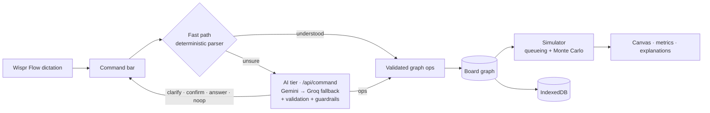

<p align="center">
  <picture>
    <source media="(prefers-color-scheme: dark)" srcset="frontend/public/brand/logo-mark-dark.svg">
    
  </picture>
</p>

<h1 align="center">Archie</h1>

<p align="center"><strong>Talk through a system. Watch it run. Watch it break.</strong></p>

<p align="center">
  <a href="LICENSE"></a>
</p>

Archie is a system-design board you talk to. You describe changes out loud ("five replicas of the API", "kill Redis"), the diagram updates, and a simulator shows where the system saturates, which requests fail, and why, with the numbers behind every red component. It's built for engineers sketching a design and for students practising system-design interviews.


> Built by voice with [Wispr Flow](https://ref.wisprflow.ai/hhg) for Hacker House Goa 2026. **Status:** in development. Phases 0–3 of 8 are done and Phase 4 (the AI harness) is in review ([roadmap](docs/29-roadmap.md), [project state](docs/31-project-state.md)).

## What works today

- **Voice commands, applied locally.** Dictate with Wispr Flow (or type) into the command bar. A deterministic parser turns commands like *"Kill Redis"*, *"Shard Postgres into two"* or *"Send fifty thousand requests a second, ninety percent reads"* into graph edits. Anything it isn't certain about is **not guessed** locally: it goes to the AI tier instead.
- **An AI tier for everything else.** Full descriptions (*"users hit two load balancers, thirty API servers, Postgres with two read replicas, and Redis"*) become validated edits. When a reference is ambiguous it asks (*"Which database?"* with tappable answers), big deletions wait for your confirmation, questions get answers that cite the simulator's numbers and highlight the components, and off-topic requests change nothing. The model only ever proposes operations: every one is validated, invalid ones get one repair attempt, and the guardrails are enforced in code.
- **Hands-free mode.** The command sends itself once your dictation has been still for 1.2 seconds.
- **A live simulator.** Every change re-runs a queueing model: per-component load and utilization (ρ), cache-aside reads, read replicas, sharding, queues with backlog, failover, end-to-end success rate, p50/p95/p99 latency, throughput and a monthly cost estimate.
- **Explanations with the math.** The bottleneck gets a note such as *"1,500 reads/s + 5,000 writes/s on 1 shard (capacity 10,000 reads / 4,000 writes per shard) → ρ = 1.40 → 28.6% of its requests dropped."*
- **Failure injection and blast radius.** *"Kill Redis"* shows success falling from 96.3% to 54.5% and which components became hot.
- **Boards in your browser.** Templates (three-tier, URL shortener, chat), undo/redo, change history, automatic layout, light and dark themes. Boards are saved in IndexedDB and never leave your browser.


### Planned

| Phase | Feature | Status |
|-------|---------|--------|
| 4 | AI tier: full descriptions ("users hit two load balancers…"), clarifying questions, confirmations, grounded answers ([plan](docs/32-phase-4-plan.md)) | 🚧 In review: built and tested with a mocked model; real-model eval numbers pending |
| 5 | Design pass: inspector, mobile layout | 📋 Planned |
| 6 | Interview mode with simulator-checked SLOs, design review | 📋 Planned |
| 7 | Eval report, share links, exports, deployment | 📋 Planned |

## Results

Measured with the scripts in this repository (`npm run bench:fast`, `npm run bench:sim`; Apple M4, Node 22). Raw results are in [`evals/results/`](evals/results/).

| What | Result | Target |
|------|--------|--------|
| Voice command, parse + apply (fast path) | P50 0.006 ms · P100 0.138 ms over 14,000 runs | P50 < 10 ms |
| Full simulation incl. 10,000-sample Monte Carlo, 100 components | P95 2.33 ms | P95 < 5 ms |
| AI command understanding, held-out test split (12 cases, free-tier Gemini → Groq) | task accuracy 91.7% · kind accuracy 100% · **0 false actions** · warm P50 1.8 s | ≥ 90% · false actions ≤ 2% · P50 < 3 s |
| AI command understanding, all 31 cases | 29/31 = 93.5% · 0 false actions | ≥ 85% (Phase 4) |
| Unit, property and contract tests | 424 passing | — |
| End-to-end tests (desktop + mobile Chromium) | 53 passing (AI responses mocked) | — |

The simulator's headline numbers are golden-tested against hand calculations in [docs/10](docs/10-traffic-model.md). It is a teaching model (M/M/1 per replica, steady state), not a vendor benchmark; assumptions are listed in [docs/09](docs/09-simulation-engine.md).

## How it works



1. You speak a command; Wispr Flow types it into the command bar.
2. The fast path matches it against an anchored grammar and resolves component names ("the db", "it", "postgres replica one"). It returns nothing unless it is certain.
3. Otherwise `/api/command` sends the board (as a compact text form), the simulator summary and the utterance to the model (a ladder of Gemini free-tier models, each with its own daily quota, then Groq's free tier when Gemini is busy or out of quota; Claude optional), which returns structured output: edits, a question, a confirmation request, an answer or a no-op. Edits are validated; invalid ones get one repair turn and then become a question.
4. The result is a batch of typed operations, validated as a whole and applied atomically, so one bad operation changes nothing.
5. The simulator re-runs on the new graph in a few milliseconds, and the canvas, metrics and explanations update.

## Tech stack

| Role | Technology |
|------|------------|
| App | Next.js 16 (App Router), React 19, TypeScript 6 |
| Canvas | React Flow, ELK layered layout in a Web Worker |
| State and storage | Zustand, IndexedDB (`idb`) |
| API | Hono, mounted at `/api` inside Next.js |
| Validation and contracts | Zod, JSON Schema + OpenAPI in [`specs/`](specs/) |
| Design | IBM Plex Sans and Mono, Lucide icons, CSS custom properties |
| Testing | Vitest, fast-check, Playwright |
| Voice | Wispr Flow (system-wide dictation) |

## Project structure

```text
frontend/    Next.js app: pages, canvas, command bar, metrics panel
backend/     Hono API: /api/health and /api/command (rate limit, optional access code)
simulator/   graph model, operations and the simulation engine (pure TypeScript)
ai/          fastpath/ command parser (browser-safe); llm/ server-only model harness (Gemini → Groq, or Claude) with quota guards
database/    IndexedDB repository and share-link codec
evals/       eval runner, cases, fixtures, benchmarks and results
specs/       JSON Schemas, OpenAPI and fixtures (machine-readable contracts)
tests/       contract and end-to-end tests
docs/        product and engineering documentation (start with 00-overview)
```

## Getting started

**Prerequisites:** Node.js 22 or newer (see `.nvmrc`) and npm.

```bash
git clone https://github.com/im-shourya/Archie.git
cd Archie
npm install
npm run dev
```

Open <http://localhost:3000>, pick **Open the 50k rps demo**, and try saying *"Shard Postgres into two."*

Local commands and the simulator need no environment variables. AI commands (anything the fast path doesn't understand) need a free `GEMINI_API_KEY` from [Google AI Studio](https://aistudio.google.com/apikey) in `.env.local`, plus an optional free `GROQ_API_KEY` from [Groq](https://console.groq.com/keys) as the fallback. Keys are server-only and never sent to the browser. Per-provider quota guards keep usage under the free tiers: when both are full, the API answers 429 rather than failing upstream. To use Claude instead, set `ANTHROPIC_API_KEY` and `ARCHIE_PROVIDER=anthropic`. Note that Google may use prompts sent on its free tier to improve its products. [`.env.example`](.env.example) lists the optional ones: `ARCHIE_PROVIDER`, `ARCHIE_FALLBACK`, `ARCHIE_MODEL`, the quota overrides (`GEMINI_RPM`, `GROQ_TPM`, …), `ARCHIE_DAILY_CAP`, `ARCHIE_ACCESS_CODE`, `ARCHIE_IP_SALT` and `NEXT_PUBLIC_SITE_URL`.

### Commands

| Command | What it does |
|---------|--------------|
| `npm run dev` | Development server with the API at `/api` |
| `npm run build` · `npm start` | Production build and server |
| `npm run lint` · `npm run typecheck` | ESLint and TypeScript across all workspaces |
| `npm test` | Unit, property and contract tests (Vitest) |
| `npm run test:e2e` | End-to-end tests (run `npx playwright install chromium` once first) |
| `npm run bench:fast` · `npm run bench:sim` | Latency benchmarks, written to `evals/results/` |
| `npm run eval` | Command-understanding eval against the real model (needs `GEMINI_API_KEY`; `GROQ_API_KEY` adds the fallback; paces itself to the free quotas); `-- --fastpath-only` for the no-AI baseline, `-- --split test` for the held-out split |
| `npm run dev:backend` | The API alone on <http://localhost:8787/api> |

## Built with Wispr Flow

Archie is being built for the Wispr Flow challenge: the coding agent receives its instructions by dictation, the docs in [`docs/`](docs/) are detailed so spoken prompts can stay short (*"Do Phase 3 from doc 29"*), and the product itself is designed for dictation, with one command bar and a hands-free mode. Challenge rules and the submission checklist are in [docs/99](docs/99-challenge.md).

## Documentation

Start with the [overview](docs/00-overview.md). Product: [idea](docs/01-idea.md) · [requirements](docs/02-requirements.md) · [spec](docs/03-product-spec.md) · [roadmap](docs/29-roadmap.md). Engineering: [architecture](docs/04-system-architecture.md) · [simulator](docs/09-simulation-engine.md) · [commands](docs/13-command-understanding.md) · [AI plan](docs/32-phase-4-plan.md) · [security](docs/20-security.md) · [decisions](docs/30-architecture-decisions.md).

## Contributing, security, license

See [CONTRIBUTING.md](CONTRIBUTING.md) and [SECURITY.md](SECURITY.md). Changes are tracked in [CHANGELOG.md](CHANGELOG.md).

Licensed under the [MIT License](LICENSE). IBM Plex fonts are used under the SIL Open Font License ([frontend/assets/fonts/OFL-IBM-Plex.txt](frontend/assets/fonts/OFL-IBM-Plex.txt)).
