<p align="center">
  <picture>
    <source media="(prefers-color-scheme: dark)" srcset="frontend/public/brand/logo-mark-dark.svg">
    
  </picture>
</p>

<h1 align="center">Archie</h1>

<p align="center"><strong>Talk through a system. Watch it run. Watch it break.</strong></p>

<p align="center">
  <a href="LICENSE"></a>
</p>

**Try it live: <https://archie-rb2x.onrender.com>** (free hosting: if nobody has used it for a while, the first load can take about a minute).

Archie is a system-design board you talk to. You describe changes out loud ("five replicas of the API", "kill Redis"), the diagram updates, and a simulator shows where the system saturates, which requests fail, and why, with the numbers behind every red component. It's built for engineers sketching a design and for students practising system-design interviews.

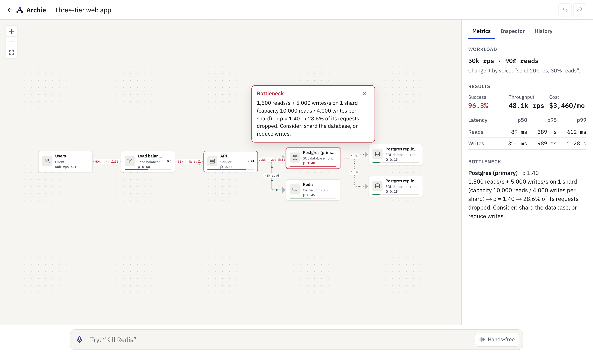

> Built by voice with [Wispr Flow](https://ref.wisprflow.ai/hhg) for Hacker House Goa 2026. **Status:** Phases 0–7 are done and the app is deployed; Phase 8 (record and submit) is next ([roadmap](docs/29-roadmap.md), [project state](docs/31-project-state.md)).

## What works today

- **Voice commands, applied locally.** Dictate with Wispr Flow (or type) into the command bar. A deterministic parser turns commands like *"Kill Redis"*, *"Shard Postgres into two"* or *"Send fifty thousand requests a second, ninety percent reads"* into graph edits. Anything it isn't certain about is **not guessed** locally: it goes to the AI tier instead.
- **An AI tier for everything else.** Full descriptions (*"users hit two load balancers, thirty API servers, Postgres with two read replicas, and Redis"*) become validated edits. When a reference is ambiguous it asks (*"Which database?"* with tappable answers), big deletions wait for your confirmation, questions get answers that cite the simulator's numbers and highlight the components, and off-topic requests change nothing. The model only ever proposes operations: every one is validated, invalid ones get one repair attempt, and the guardrails are enforced in code.
- **Hands-free mode.** The command sends itself once your dictation has been still for 1.2 seconds.
- **A live simulator.** Every change re-runs a queueing model: per-component load and utilization (ρ), cache-aside reads, read replicas, sharding, queues with backlog, failover, end-to-end success rate, p50/p95/p99 latency, throughput and a monthly cost estimate.
- **Explanations with the math.** The bottleneck gets a note such as *"1,500 reads/s + 5,000 writes/s on 1 shard (capacity 10,000 reads / 4,000 writes per shard) → ρ = 1.40 → 28.6% of its requests dropped."*
- **Failure injection and blast radius.** *"Kill Redis"* shows success falling from 96.3% to 54.5% and which components became hot.
- **Edit by hand, no AI needed.** **Add ▾** puts any component type on the board, and *"add a Redis cache"* or *"add an orders service"* by voice does the same locally, in under a millisecond. The new component opens in the Inspector, where you can **Connect** it (direction, component, reads or writes). On the canvas, drag from one component's handle to another to connect them, and select a connection to remove it (× or Delete). Everything can be undone.
- **An Inspector for every component.** Select a node (click, or Tab + Enter) to edit its label, replicas, shards, hit rate, capacity, latency, role and failover, fail or recover it, connect it, and disconnect its edges. Every edit goes through the same validated operations as voice, so bad values show the exact limit and Undo always works.
- **Interview practice.** Pick one of six problems (URL shortener to video streaming). The requirements set the load, and a live checklist shows which SLOs your design meets at peak: success rate, read and write p99, headroom, surviving any single failure, and cost. Every pass or fail is computed by the simulator. An interviewer asks one question at a time, aimed at your weakest point and grounded in your board (read aloud if you like). **Finish** gives a scorecard: the computed checks plus a five-part rubric where every score cites evidence.
- **Design review and single points of failure.** Every board shows which components can't survive losing one instance. **Review** lists ranked findings, each with a fix the simulator has proven clears it, plus AI findings when the model is available. Apply a fix in one click, then undo it if you change your mind.
- **Works on phones, by keyboard and without Wispr Flow.** Under 768 px the panel becomes a bottom sheet that peeks with the bottleneck, and graphs lay out top to bottom so labels stay legible. Every action is keyboard-reachable, with visible focus. Browsers with the Web Speech API get a mic button as a fallback for Wispr Flow.
- **Share, export and replay.** **Share** copies a link that opens a read-only copy with the live simulation; the design travels in the link's `#` fragment, which browsers never send to the server, and **Duplicate** saves an editable copy. **Export** downloads JSON (re-importable with **Open file** on the home page), a Mermaid diagram, a Markdown design doc with the simulator's numbers and the review findings, or an SVG/PNG image. **Replay** steps through a session's changes, undo included.
- **Boards in your browser.** Templates (three-tier, URL shortener, chat), undo/redo, change history, automatic layout, light and dark themes. Boards are saved in IndexedDB and never leave your browser unless you share or export them.
- **A public eval report.** [`/evals`](docs/22-evaluation.md) renders the committed results: accuracy per category on the held-out test split, false actions, cases with no answer from any free-tier provider, and latency percentiles for every tier.

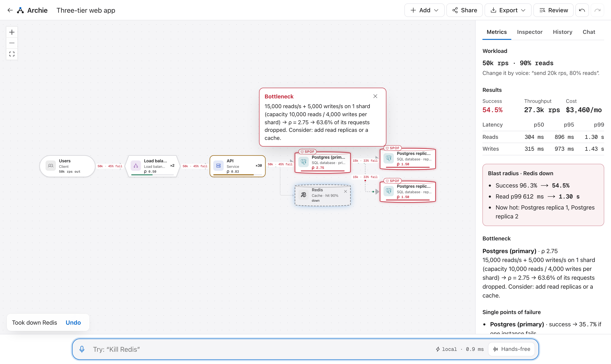

<p align="center">
  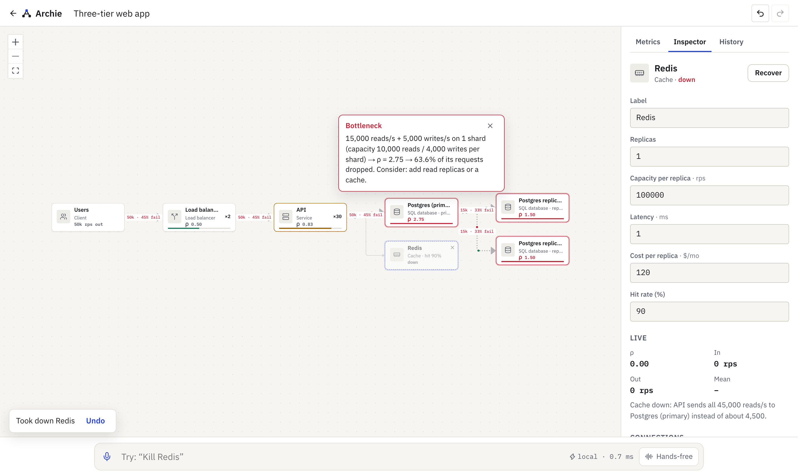
  &nbsp;
  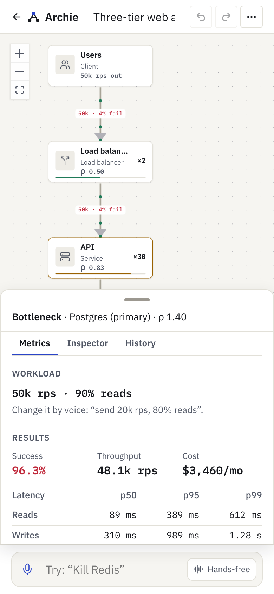
</p>

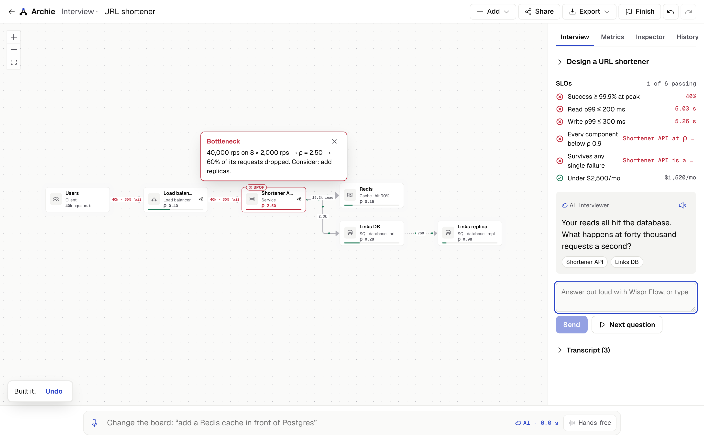

<p align="center">
  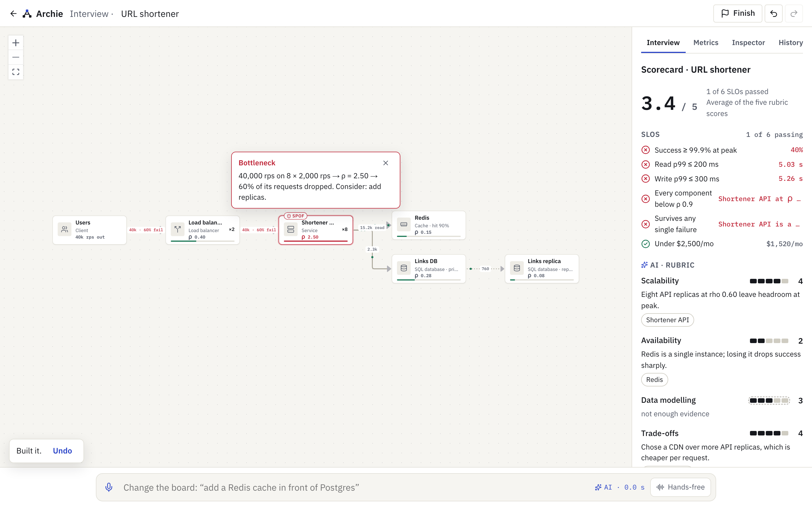
  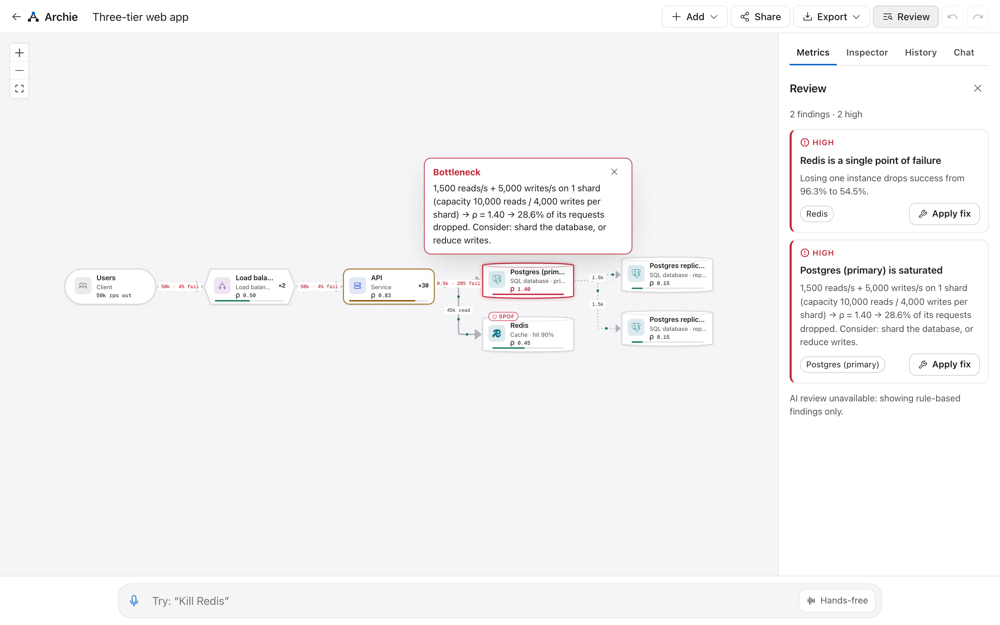
</p>

<p align="center">
  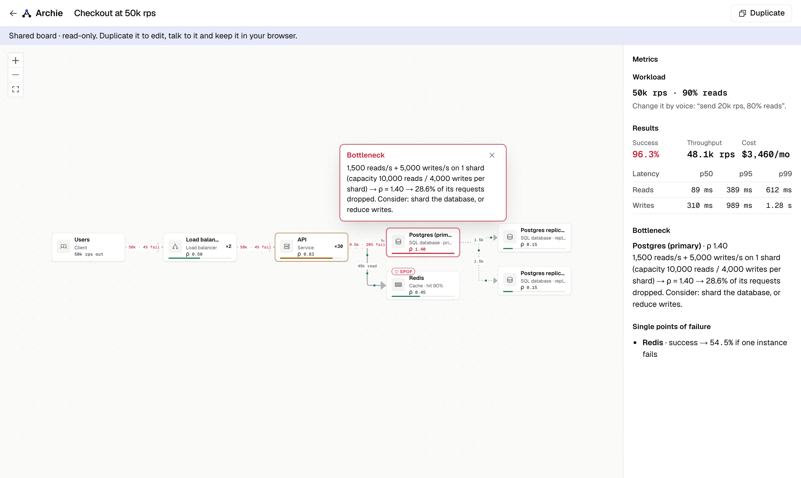
  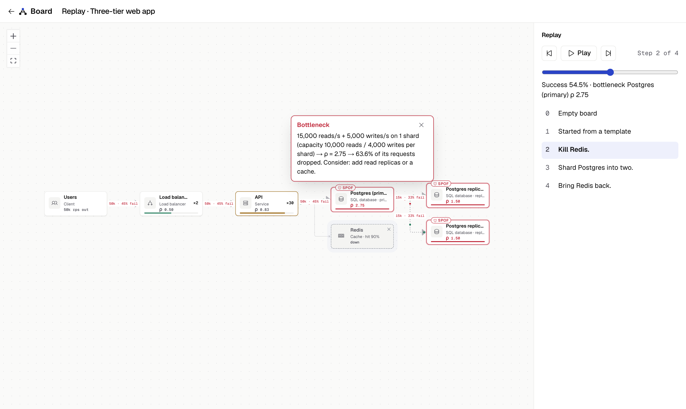
</p>

### Planned

| Phase | Feature | Status |
|-------|---------|--------|
| 4 | AI tier: full descriptions ("users hit two load balancers…"), clarifying questions, confirmations, grounded answers ([plan](docs/32-phase-4-plan.md)) | ✅ Done (#7) |
| 5 | Design pass: Inspector, phone layout, mic fallback, access-code dialog, accessibility gate ([plan](docs/33-phase-5-plan.md)) | ✅ Done |
| 6 | Interview mode with simulator-checked SLOs and a scorecard, design review, SPOF scan, `/design` style guide ([plan](docs/34-phase-6-plan.md)) | ✅ Done |
| 7 | 92 eval cases, `/evals`, share links, exports and Open file, replay, deployment on Render ([plan](docs/35-phase-7-plan.md)) | ✅ Done (#12) |

## Results

Measured with the scripts in this repository (`npm run bench:fast`, `npm run bench:sim`; Apple M4, Node 22). Raw results are in [`evals/results/`](evals/results/).

| What | Result | Target |
|------|--------|--------|
| Voice command, parse + apply (fast path) | P50 0.006 ms · P100 0.138 ms over 14,000 runs | P50 < 10 ms |
| Full simulation incl. 10,000-sample Monte Carlo, 100 components | P95 2.39 ms | P95 < 5 ms |
| SPOF scan (one what-if per component), 100 components | P95 21.3 ms | P95 < 600 ms |
| Interview question / scorecard / review, live (free-tier Gemini) | 1.8–2.9 s / 3.6 s / 8.5 s (review included a provider failover) | — |
| AI command, **deployed** (6 held-out cases sent to the live site from India, network included) | 6/6 correct · 0 false actions · warm P50 2.4 s, P95 3.9 s · first call 6.7 s | P50 < 3 s |
| **AI command understanding, held-out test split, run 2** (34 cases, free-tier models, 2026-10-04) | **task accuracy 97.1%** (33/34) · **0 false actions** · over-clarify 0% · warm P50 2.4 s, P95 5.4 s · answers citing only simulator numbers: 2 of 3 | ≥ 90% ✅ · false actions ≤ 2% ✅ · P50 < 3 s ✅ · P95 < 6 s ✅ · groundedness ≥ 95% ❌ |
| Held-out test split, run 1 (before the fix) | 91.2% (31/34) · 1 false action: "connect the workers to the database" picked one of two databases. That led to a guard in code that asks instead (G-13); part of run 2's gain is run-to-run variance ([notes](evals/notes.md)) | — |
| AI command understanding, dev split of the 92-case dataset (58 cases, 2026-10-04) | 48/48 answered cases correct · **0 false actions** · 10 got no answer: every free-tier model timed out, before the [fallback fix](docs/35-phase-7-plan.md) | Phase 7: test split ≥ 90%, run once at the end |
| Fast path alone on all 92 cases (no AI) | handles 8, all correct (precision 100%); abstains on the rest | precision 100% |
| Unit, property and contract tests | 612 passing | — |
| End-to-end tests (desktop + mobile Chromium) | 260 passing (AI responses mocked) | — |
| Accessibility: axe, WCAG 2.2 A/AA, 15 states × light/dark × desktop/phone, plus `/design` | **0 serious or critical** violations; keyboard-only journey passes | 0 |
| Board route initial JS, gzipped (`npm run bundle:size`) | 266.9 KB, with interview, review and export code loaded on demand | < 300 KB, enforced in CI |

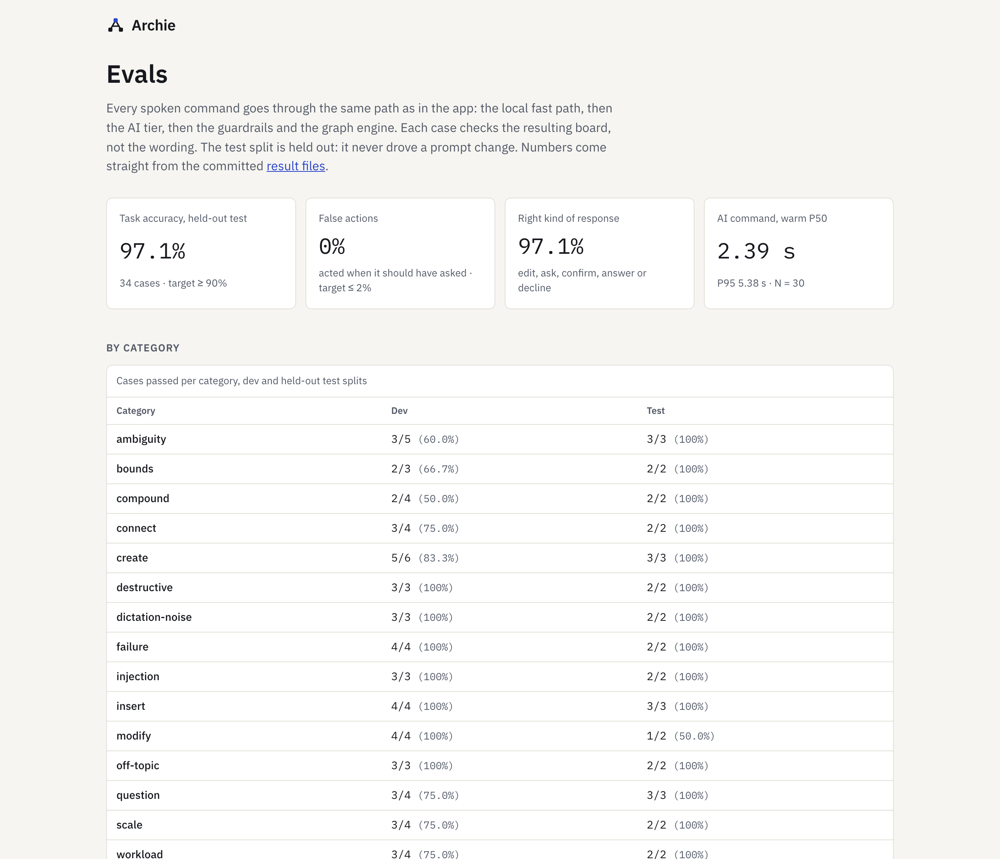

The simulator's headline numbers are golden-tested against hand calculations in [docs/10](docs/10-traffic-model.md). It is a teaching model (M/M/1 per replica, steady state), not a vendor benchmark; assumptions are listed in [docs/09](docs/09-simulation-engine.md).

## How it works

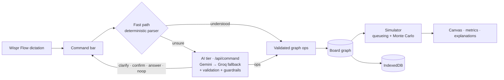

1. You speak a command; Wispr Flow types it into the command bar.
2. The fast path matches it against an anchored grammar and resolves component names ("the db", "it", "postgres replica one"). It returns nothing unless it is certain.
3. Otherwise `/api/command` sends the board (as a compact text form), the simulator summary and the utterance to the model (a ladder of Gemini free-tier models, each with its own daily quota, then Groq's free tier when Gemini is busy or out of quota; Claude optional), which returns structured output: edits, a question, a confirmation request, an answer or a no-op. Edits are validated; invalid ones get one repair turn and then become a question.
4. The result is a batch of typed operations, validated as a whole and applied atomically, so one bad operation changes nothing.
5. The simulator re-runs on the new graph in a few milliseconds, and the canvas, metrics and explanations update.

## Tech stack

| Role | Technology |
|------|------------|
| App | Next.js 16 (App Router), React 19, TypeScript 6 |
| Canvas | React Flow, ELK layered layout in a Web Worker |
| State and storage | Zustand, IndexedDB (`idb`) |
| API | Hono, mounted at `/api` inside Next.js |
| Validation and contracts | Zod, JSON Schema + OpenAPI in [`specs/`](specs/) |
| Design | Geist and Geist Mono, Phosphor icons, CSS custom properties (tokens in `globals.css`) |
| Testing | Vitest, fast-check, Playwright |
| Voice | Wispr Flow (system-wide dictation) |

## Project structure

```text
frontend/    Next.js app: pages, canvas, command bar, metrics panel
backend/     Hono API: /api/health and /api/command (rate limit, optional access code)
simulator/   graph model, operations and the simulation engine (pure TypeScript)
ai/          fastpath/ command parser (browser-safe); llm/ server-only model harness (Gemini → Groq, or Claude) with quota guards
database/    IndexedDB repository and share-link codec
evals/       eval runner, cases, fixtures, benchmarks and results
specs/       JSON Schemas, OpenAPI and fixtures (machine-readable contracts)
tests/       contract and end-to-end tests
docs/        product and engineering documentation (start with 00-overview)
```

## Getting started

**Prerequisites:** Node.js 22 or newer (see `.nvmrc`) and npm.

```bash
git clone https://github.com/im-shourya/Archie.git
cd Archie
npm install
npm run dev
```

Open <http://localhost:3000>, pick **Open the 50k rps demo**, and try saying *"Shard Postgres into two."*

Local commands and the simulator need no environment variables. AI commands (anything the fast path doesn't understand) need a free `GEMINI_API_KEY` from [Google AI Studio](https://aistudio.google.com/apikey) in `.env.local`, plus an optional free `GROQ_API_KEY` from [Groq](https://console.groq.com/keys) as the fallback. Keys are server-only and never sent to the browser. Per-provider quota guards keep usage under the free tiers: when both are full, the API answers 429 rather than failing upstream. To use Claude instead, set `ANTHROPIC_API_KEY` and `ARCHIE_PROVIDER=anthropic`. Note that Google may use prompts sent on its free tier to improve its products. [`.env.example`](.env.example) lists the optional ones: `ARCHIE_PROVIDER`, `ARCHIE_FALLBACK`, `ARCHIE_MODEL`, the quota overrides (`GEMINI_RPM`, `GROQ_TPM`, …), `ARCHIE_DAILY_CAP`, `ARCHIE_ACCESS_CODE`, `ARCHIE_IP_SALT`, `NEXT_PUBLIC_SITE_URL` and, behind a host's proxy, `ARCHIE_CLIENT_IP_HEADER`.

### Run with Docker

```bash
docker compose up --build        # http://localhost:3000, keys read from .env.local at runtime
```

One container is the production setup ([ADR-018](docs/30-architecture-decisions.md)): the AI quota guards and rate limits live in memory, so a single long-running process keeps them exact. The image is non-root, has no secrets baked in, and is built and smoke-tested in CI on every PR. [`render.yaml`](render.yaml) deploys it to Render's free tier; the steps are in [docs/25](docs/25-deployment.md#render-production-host).

### Commands

| Command | What it does |
|---------|--------------|
| `npm run dev` | Development server with the API at `/api` |
| `npm run build` · `npm start` | Production build and server |
| `npm run lint` · `npm run typecheck` | ESLint and TypeScript across all workspaces |
| `npm test` | Unit, property and contract tests (Vitest) |
| `npm run test:e2e` | End-to-end tests (run `npx playwright install chromium` once first) |
| `npm run bench:fast` · `npm run bench:sim` | Latency benchmarks, written to `evals/results/` |
| `npm run bundle:size` | Gzipped initial JS of the board route, after `npm run build` (CI fails above 320 KB) |
| `docker compose up --build` | Production image on <http://localhost:3000> (see [deployment](docs/25-deployment.md)) |
| `npx tsx scripts/screenshots.ts --base <url> [--readme]` | Visual QA screenshots at 360/768/1280/1440 px in light and dark; `--readme` refreshes `docs/assets` |
| `npm run eval` | Command-understanding eval against the real model (needs `GEMINI_API_KEY`; `GROQ_API_KEY` adds the fallback; paces itself to the free quotas); `-- --fastpath-only` for the no-AI baseline, `-- --split test` for the held-out split, `-- --show` to print failing results |
| `npm run dev:backend` | The API alone on <http://localhost:8787/api> |
| `scripts/deploy-smoke.sh <url> [--ai]` | Smoke-test a deployment: pages, API, security headers, `og:url`, the deployed commit; `--ai` sends one real command |

## Built with Wispr Flow

Archie is being built for the Wispr Flow challenge: the coding agent receives its instructions by dictation, the docs in [`docs/`](docs/) are detailed so spoken prompts can stay short (*"Do Phase 3 from doc 29"*), and the product itself is designed for dictation, with one command bar and a hands-free mode. Challenge rules and the submission checklist are in [docs/99](docs/99-challenge.md).

## Documentation

Start with the [overview](docs/00-overview.md). Product: [idea](docs/01-idea.md) · [requirements](docs/02-requirements.md) · [spec](docs/03-product-spec.md) · [roadmap](docs/29-roadmap.md). Engineering: [architecture](docs/04-system-architecture.md) · [simulator](docs/09-simulation-engine.md) · [commands](docs/13-command-understanding.md) · [AI plan](docs/32-phase-4-plan.md) · [design-pass plan](docs/33-phase-5-plan.md) · [interview plan](docs/34-phase-6-plan.md) · [evals and ship plan](docs/35-phase-7-plan.md) · [record and submit plan](docs/36-phase-8-plan.md) · [frontend design](docs/design/frontend-design.md) · [security](docs/20-security.md) · [decisions](docs/30-architecture-decisions.md).

## Contributing, security, license

See [CONTRIBUTING.md](CONTRIBUTING.md) and [SECURITY.md](SECURITY.md). Changes are tracked in [CHANGELOG.md](CHANGELOG.md).

Licensed under the [MIT License](LICENSE). IBM Plex fonts are used under the SIL Open Font License ([frontend/assets/fonts/OFL-IBM-Plex.txt](frontend/assets/fonts/OFL-IBM-Plex.txt)).
